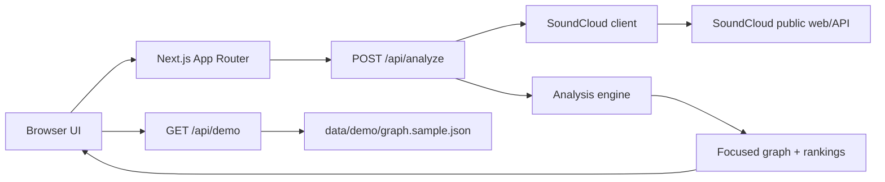
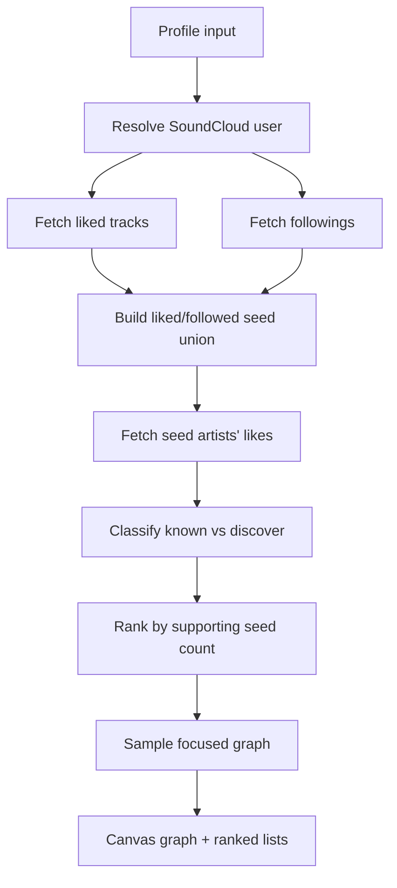

# SoundCloud Explorer

SoundCloud Explorer answers one question:

> Which artists are listened to by artists I like or follow on SoundCloud, and do I know them already?

The app builds a two-hop taste graph from a public SoundCloud profile. First it finds the artists behind tracks the profile liked and artists the profile follows. Those artists become seed nodes. Then it fetches the artists those seed artists like, ranks the overlap, and splits the results into:

- **Artists to discover**: liked by seed artists, not already liked/followed by the profile you analyze.
- **Known artists**: already liked/followed by the profile you analyze and also supported by seed artists.
- **Seed artists**: artists directly liked or followed by the profile you analyze.

The production app is a TypeScript Next.js App Router application designed for Vercel.

## Architecture





### Key modules

- `src/app/page.tsx`: responsive explorer UI.
- `src/app/api/analyze/route.ts`: Vercel/Next route for live analysis.
- `src/app/api/demo/route.ts`: serves the small public demo fixture.
- `src/lib/soundcloud.ts`: SoundCloud profile parsing, `client_id` discovery, resolve, likes, followings, pagination, and timeouts.
- `src/lib/analysis.ts`: pure seed merging, known/discover classification, ranking, and graph sampling.
- `src/components/NetworkGraph.tsx`: client-only `react-force-graph-2d` canvas renderer.

## Setup

```bash
npm install
npm run dev
```

Open `http://localhost:3000`.

Useful commands:

```bash
npm run lint
npm run test
npm run build
npm run test:e2e
```

`npm run test:e2e` uses Playwright and may require browser installation with `npx playwright install` on a fresh machine.

## API

### `POST /api/analyze`

Request:

```ts
{
  profile: string;
  maxSeedArtists?: number; // default 40, capped at 80
  likesPerSeed?: number;   // default 50, capped at 100
  graphDensity?: "focused" | "expanded"; // default focused
}
```

Response:

```ts
{
  profile: ArtistRef;
  metrics: {
    seeds: number;
    knownTotal: number;
    discoverTotal: number;
    renderedNodes: number;
    renderedEdges: number;
    failedSeeds: number;
  };
  graph: {
    nodes: GraphNode[];
    links: GraphLink[];
  };
  rankings: {
    discover: RankedArtist[];
    known: RankedArtist[];
  };
  warnings: string[];
  generatedAt: string;
}
```

Core types live in `src/lib/contracts.ts`.

## How The Analysis Works

1. Normalize the profile input from either `username` or a SoundCloud profile URL.
2. Resolve the profile to a SoundCloud user ID.
3. Fetch target liked tracks and target followings.
4. Extract artists from liked tracks/playlists and followed users.
5. Build a deduplicated seed union with `seedSource: "liked" | "followed" | "both"`.
6. Fetch each seed artist's liked tracks up to the configured cap.
7. Mark a second-degree artist as known if the analyzed profile already liked or followed them.
8. Rank known and discovery candidates by supporting seed count.
9. Return large ranked lists but only a focused graph slice for browser performance.

## Demo Data And Public Repo Policy

The public repo intentionally does not commit full personal SoundCloud caches. The local cache files below are ignored:

- `liked_artists.json`
- `seed_artist_likes_cache.json`
- `artists_to_discover.txt`
- `liked_artist_graph.html`

The committed fixture at `data/demo/graph.sample.json` is a small fictional graph used for first-load UX, tests, and screenshots.

If you have the ignored local cache files, rebuild the demo fixture with:

```bash
npm run generate:demo
```

Review the generated file before publishing if you use real cache data.

## Vercel Deployment

1. Push the repository to GitHub.
2. Import the repo in Vercel.
3. Keep the default Next.js settings:
   - install command: `npm install`
   - build command: `npm run build`
   - output: managed by Next.js
4. Deploy.

No SoundCloud secret is required. The app discovers a public SoundCloud `client_id` at runtime from SoundCloud web assets.

## Limits And Tradeoffs

- SoundCloud does not provide a stable public API contract for this use case. The app handles common failures and returns warnings for partial seed failures.
- Vercel Function response payloads are limited, so the API returns capped rankings and a sampled graph rather than the full second-degree graph.
- Default analysis is capped at 40 seed artists and 50 likes per seed. The API enforces maximums of 80 and 100.
- Full historic cache files can contain tens of thousands of artists and should be treated as private local data unless intentionally published.

Vercel references:

- [Function duration](https://vercel.com/docs/functions/configuring-functions/duration)
- [Function payload limits](https://vercel.com/docs/functions/limitations)
- [Next.js on Vercel](https://vercel.com/docs/frameworks/full-stack/nextjs)
